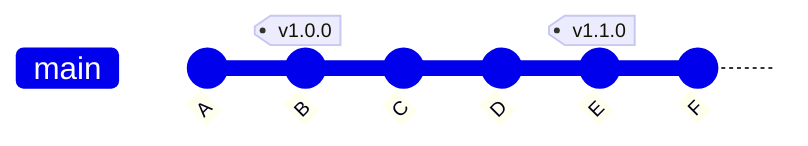

# 9. Релизы — теги, версии, GitHub Release

**Коротко.** Релиз — момент, когда говорят «вот эта версия готова, берите». В git его
отмечают **тегом** — постоянной меткой на коммите, например `v1.2.0`. На GitHub к тегу
добавляют **Release**: страницу с описанием изменений и файлами для скачивания.

## Тег — ветка, которая не двигается

Ветка — ярлычок, который переезжает с каждым новым коммитом. Тег — ярлычок, который
навсегда приклеен к одному коммиту. Поэтому по тегу всегда можно получить ровно ту
версию, которую выпустили, даже через год.



`main` уже ушёл на `F`, а `v1.0.0` и `v1.1.0` стоят на месте.

## Номер версии: MAJOR.MINOR.PATCH

Почти везде версию пишут по правилам **SemVer** — три числа через точку:

| Что растёт | Когда | Пример |
|---|---|---|
| **PATCH** — третье | исправления, ничего нового и ничего не ломается | `1.2.0` → `1.2.1` |
| **MINOR** — второе | новое, но старое продолжает работать | `1.2.1` → `1.3.0` |
| **MAJOR** — первое | что-то сломается у тех, кто уже пользуется: переименовали, удалили | `1.3.0` → `2.0.0` |

Когда растёт левое число, правые обнуляются. Версия `0.x` — «ещё не стабильно».

## Changelog — что нового

**Changelog** — список изменений по версиям, обычно файл `CHANGELOG.md`: новые версии
сверху, у каждой — дата и что добавилось, исправилось, сломалось. Его читают люди,
которые решают, обновляться ли.

## Как сделать

> **В GitHub.** Справа на странице репозитория — **Releases** → **Draft a new release** →
> **Choose a tag**: впиши новый, например `v1.1.0` (создастся на последнем коммите выбранной
> ветки) → название и описание (кнопка **Generate release notes** соберёт список слитых PR) →
> при необходимости приложи файлы → **Publish release**. Галочка **Set as the latest release**
> делает его «последним» — на него ведут ссылки `releases/latest`.
>
> **Попросить Claude.** «Подготовь релиз 1.1.0: подними версию, допиши changelog, открой PR».
> После merge: «создай тег `v1.1.0` и GitHub Release с описанием из changelog».
> Релиз — решение человека: Claude готовит, а «выпускаем» говоришь ты (или тот, кто утверждает).

<small>Команды:</small>

```bash
git tag v1.1.0                     # поставить тег на текущий коммит
git push origin v1.1.0             # теги отправляются отдельно
gh release create v1.1.0 --title "1.1.0" --notes "Что нового…"
```

## Частые ошибки

- **Тег не на том коммите.** Тег ставят на коммит в `main` после merge, а не на коммит
  в ветке, которая ещё не слита.
- **Тег запушили и передвинули.** Кто-то уже скачал «`v1.1.0`», а это теперь другой код.
  Ошибся — выпусти `v1.1.1`, не переписывай выпущенное.
- **Версия в файле и в теге разные.** Если версия записана в проекте (`package.json`, `VERSION`),
  её поднимают вместе с релизом.

## Как это в AID

- **Релиз утверждает владелец продукта**: версию, changelog, GitHub Release. В продуктах PD —
  с согласия PD, в продуктах инженеров (Library Updater, Bot · Request) — сам инженер
  в своём репозитории.
- **Метка Latest в `RickOBrian/aid` — только у Token Comparator.** Кнопка «Скачать плагин»
  в Presentbook ведёт на `releases/latest/download/token-comparator.zip`. Поэтому каждый релиз
  плагина кладёт два одинаковых файла — `token-comparator-vX.Y.Z.zip` и `token-comparator.zip` —
  и делает релиз Latest. Другие продукты в этом репозитории выпускаются **без** Latest и со
  своим префиксом тега — иначе кнопка начнёт отдавать не тот плагин.
- **Версия и changelog — только на границе релиза.** Одно из трёх правил AID, которые
  действуют всегда: не писать версию и changelog вне релиза.
- **Пример.** Library Updater: `v1.0.0` (2026-10-08) и `v1.1.0` (2026-10-09, Latest) —
  релизы в репозитории
  инженера; заодно номер в `package.json` подняли до `1.0.0`, чтобы совпадал с релизом.

*Источники: корневой `CLAUDE.md` («Стыки между продуктами», «Гейты», «Git-полномочия»),
`docs/hub/ORCHESTRATION.md` §9, `skills/_shared/protocols/gates/release-gate.md` —
репозиторий `RickOBrian/aid`, сверено 2026-10-12.*

## Проверь себя

1. В плагине исправили опечатку в подсказке. Версия была `1.4.2`. Какая будет?
   <details><summary>Ответ</summary>`1.4.3` — исправление без нового и без поломок.</details>
2. Переименовали поле, на которое опираются другие. Версия была `1.4.3`.
   <details><summary>Ответ</summary>`2.0.0` — у тех, кто пользуется, сломается.</details>
3. Чем тег отличается от ветки?
   <details><summary>Ответ</summary>Ветка переезжает на каждый новый коммит, тег навсегда
   остаётся на одном.</details>
