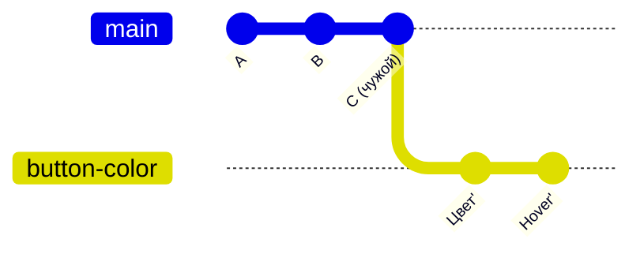

# 13. Продвинутое

Без этой главы можно работать: всё основное — в главах 1–12. Здесь — то, что встречается
в ответах Claude и в разговорах опытных коллег. Читай, когда встретишь слово и захочешь понять.

## Rebase — переставить ветку на свежий `main`

Ты начал ветку утром, а к вечеру в `main` появились чужие коммиты. Подтянуть их можно двумя
способами:

**Merge** (глава 6) — коммит-шов соединяет `main` с твоей веткой. **Rebase** — твои коммиты
как бы снимаются и заново кладутся поверх свежего `main`, будто ты начал работу только что:



История получается прямой, без швов. Но коммиты при этом — **новые** (у них другие номера,
поэтому штрих `'`): старые `Цвет` и `Hover` заменены копиями.

**Главное правило rebase:** переставлять можно только **свою** ветку, которой больше никто
не пользуется. Если ветка уже запушена, после rebase её придётся отправить с `--force-with-lease`
(более осторожный force: откажется, если на GitHub появилось что-то, чего ты не видел).
Rebase общей ветки или `main` ломает историю всем.

> **Попросить Claude.** «Переставь мою ветку на свежий `main` через rebase и запушь
> с `--force-with-lease`». При конфликтах rebase останавливается на каждом коммите — решать
> придётся по одному.

`git pull --rebase` — то же при pull: твои неотправленные коммиты ложатся поверх
забранных, без шва.

## Cherry-pick — взять один коммит

Нужен один конкретный коммит из другой ветки, а не вся ветка? Cherry-pick копирует его
в текущую ветку новым коммитом. Например, исправление уже есть в чужой незаконченной ветке,
а нужно оно тебе сейчас.

> **Попросить Claude.** «Возьми коммит `abc123` из ветки `feat/cards` в мою ветку».

## Stash — отложить правки

Правки не готовы для коммита, а нужно срочно переключиться на другую ветку. Stash убирает
незакоммиченные правки «на полку» и возвращает рабочую папку к последнему коммиту. Потом
их можно достать — в той же или другой ветке.

> **Попросить Claude.** «Отложи мои правки» → … → «Верни отложенные правки».
> Не копи полку: забытый stash легко потерять из виду.

## Worktree — две папки одного репозитория

Обычно у репозитория одна рабочая папка, и в ней в каждый момент одна ветка. **Worktree** —
вторая (третья…) рабочая папка того же репозитория на другой ветке. История общая, а файлы —
свои у каждой папки, поэтому можно одновременно работать в двух ветках, не переключаясь.

```
D:\Projects\aid            ← main
D:\Projects\aid-hub        ← ветка доски Штаба
D:\Projects\aid-presentbook ← ветка Presentbook
```

> **Попросить Claude.** «Сделай worktree для ветки `fix/header` в папке `D:\Projects\app-fix`».
> Удалять worktree — тоже через Claude («удали worktree»), а не просто удалением папки.

## Цепочка PR — второй PR поверх первого

Большую работу удобно разбить: PR №1 — основа, PR №2 — продолжение, сделанное **от ветки PR №1**
(base у PR №2 — ветка первого, а не `main`). Так ревьюить проще, а ждать слияния первого не нужно.

Ловушки две:

1. **Удаление ветки первого закроет второй.** Если base у PR №2 — ветка PR №1, а её после merge
   удалят, GitHub закроет PR №2. Поэтому **до** merge первого переводят второй на `main`:
   на странице PR №2 — **Edit** рядом с заголовком → base: `main`.
2. **После squash-merge первого** коммиты PR №1 в `main` превратились в один новый коммит,
   а ветка второго всё ещё содержит старые. Её переставляют на свежий `main`, оставляя только
   свои коммиты: `rebase --onto`.

> **Попросить Claude.** «PR №1 слили через squash — перенеси ветку PR №2 на свежий `main`
> через `rebase --onto` и запушь».

<small>Команды:</small>

```bash
gh pr edit 2 --base main                     # до merge первого: второй — на main
git fetch
git rebase --onto origin/main feat-part-1 feat-part-2   # оставить только коммиты второго
git push --force-with-lease
```

`feat-part-1` в команде — это «где кончались коммиты первого PR». Если ветку первого уже
удалили и у тебя на компьютере, вместо имени подставляют номер её последнего коммита — он
виден во вкладке **Commits** слитого PR №1. Claude найдёт его сам.

## Как это в AID

- **Worktree — основа параллельной работы чатов.** Каждый чат AID работает в своей папке
  (worktree) на своей ветке, чтобы один чат не переключил ветку под другим посреди работы.
  Удаление worktree — только с согласия.
- **`pull --rebase` для памяти скиллов.** Журналы памяти синхронизируются через
  `git pull --rebase`: «Никогда не используй `--merge` для синхронизации memory/».
- **Правило цепочки PR** записано в `CLAUDE.md` плагина Components Swapper: перед слиянием
  первого — `gh pr edit N --base main`, после — `git rebase --onto`.

*Источники: корневой `CLAUDE.md` и `skills/_shared/protocols/git-workflow.md` §1 — репозиторий
`RickOBrian/aid`; `CLAUDE.md` репозитория `figma-components-swapper`, раздел «Git»;
сверено 2026-10-12.*

## Проверь себя

1. Можно ли сделать rebase ветки, в которую пушит ещё и коллега?
   <details><summary>Ответ</summary>Нельзя без договорённости: rebase создаёт новые коммиты,
   и история у коллеги разойдётся с твоей.</details>
2. Чем worktree отличается от второго клона репозитория?
   <details><summary>Ответ</summary>У worktree общая история с основной папкой: коммит,
   сделанный в одной, сразу виден в другой. Второй клон — независимая копия.</details>
3. PR №2 сделан от ветки PR №1. Что сделать до merge PR №1?
   <details><summary>Ответ</summary>Перевести base PR №2 на `main`, иначе удаление ветки
   первого закроет второй.</details>
